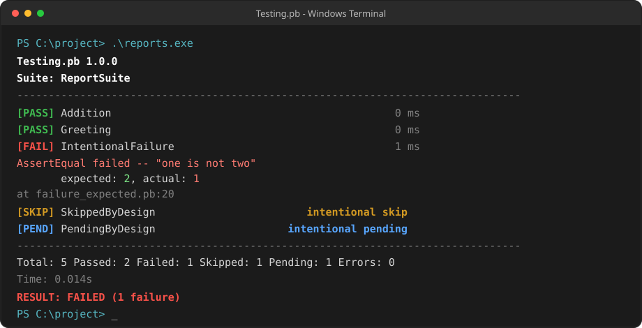

# Testing.pb

[Русский](./docs/ru.md) | **English**

A single-file unit-testing framework for PureBasic.
No external dependencies, no modules to install, no mandatory
configuration.



## Contents

1. [What it is](#what-it-is)
2. [Quick start](#quick-start)
3. [Test lifecycle and statuses](#test-lifecycle-and-statuses)
4. [Assertions](#assertions)
5. [BeforeEach and AfterEach hooks](#beforeeach-and-aftereach-hooks)
6. [Skip, pending and errors](#skip-pending-and-errors)
7. [Running tests and exit codes](#running-tests-and-exit-codes)
8. [Terminal output](#terminal-output)
9. [Compiler directives](#compiler-directives)
10. [Log file](#log-file)
11. [JSON report](#json-report)
12. [JUnit XML](#junit-xml)
13. [CI](#ci)
14. [Public API](#public-api)
15. [Testing the framework itself](#testing-the-framework-itself)
16. [Examples](#examples)
17. [Limitations](#limitations)
18. [Versioning](#versioning)
19. [License](#license)

## What it is

`Testing.pbi` is a compact but complete unit-testing framework for PureBasic.
Include it with one line:

```purebasic
IncludeFile "Testing.pbi"
```

It requires no separate runner executable, no project settings and no
`UseModule`. Every assertion writes to an internal result model; renderers
(console, log, JSON, JUnit) only read that model. A single run can therefore be
shown to a human and consumed by CI at the same time.

Key properties:

- one file, no dependencies, no external module files;
- the minimal test stays short: `Test()` → assertions → `EndTest()`;
- statuses `passed`, `failed`, `skipped`, `pending`, `error`;
- diagnostics with expected/actual values, description, file and line;
- `BeforeEach`/`AfterEach`, with `AfterEach` running even after a failure;
- colored output through `ConsoleColor()` plus fully ASCII decorations;
- UTF-8 sources and full Unicode support in the console, log, JSON and JUnit,
  including emoji and surrogate pairs;
- log file, JSON and JUnit XML;
- CI-friendly exit codes;
- its own test suite and runner scripts.

## Quick start

Create `tests.pb` next to `Testing.pbi`:

```purebasic
EnableExplicit
IncludeFile "Testing.pbi"

Test(Addition)
  AssertEqual(2 + 2, 4)
EndTest(Addition)

Test(Greeting)
  Define greeting.s = "Hello, PureBasic"
  AssertStrEqual(greeting, "Hello, PureBasic")
EndTest(Greeting)

RunAll()
```

Compile it as a console program and run it:

```text
pbcompiler tests.pb /OUTPUT tests.exe /CONSOLE
tests.exe
```

Default output:

```text
Testing.pb 1.0.0
Suite: Default
--------------------------------------------------------------------------------
[PASS] Addition                                                             0 ms
[PASS] Greeting                                                             0 ms
--------------------------------------------------------------------------------
Total: 2  Passed: 2  Failed: 0  Skipped: 0  Pending: 0  Errors: 0
Time:    0.000s
RESULT: OK
```

`RunAll()` exits the process with code `0` on success and `1` on a failure or
error by default. To continue after the run, use `RunAll(#False)`: it returns
`#True`/`#False` and leaves the process exit code to you.

## Test lifecycle and statuses

Tests are declared with macros:

```purebasic
Test(MyTest)
  ; assertions
EndTest(MyTest)
```

`EndTest` registers the procedure. Test names must be unique PureBasic
identifiers; declaring the same test twice is a compile-time error.

The statuses are exactly:

| Status    | Tag      | Meaning                                   |
| --------- | -------- | ----------------------------------------- |
| `passed`  | `[PASS]` | the test reached the end without failures |
| `failed`  | `[FAIL]` | an assertion failed                       |
| `skipped` | `[SKIP]` | skipped by `SkipTest("reason")`           |
| `pending` | `[PEND]` | deferred by `PendingTest("reason")`       |
| `error`   | `[ERR]`  | explicit error via `FailTest("message")`  |

`skipped` and `pending` are not failures: the result is `RESULT: OK` and the
exit code is `0`. `failed` and `error` produce `RESULT: FAILED (...)` and exit
code `1`.

A failed assertion terminates the current test immediately
(`ProcedureReturn #False`) but does not stop the suite: later tests still run,
and `AfterEach` still runs. Assertions therefore must be used inside a test or
hook procedure, not in main scope.

## Assertions

Every assertion accepts an optional description, which is included in
diagnostics and reports.

| Macro                                                                     | Checks                                        |
| ------------------------------------------------------------------------- | --------------------------------------------- |
| `Assert(expression, description = "")`                                    | expression is true                            |
| `AssertEqual(actual, expected, description = "")`                         | numbers are equal                             |
| `AssertNotEqual(actual, notExpected, description = "")`                   | numbers differ                                |
| `AssertBigger(actual, threshold, description = "")`                       | `actual > threshold`                          |
| `AssertSmaller(actual, threshold, description = "")`                      | `actual < threshold`                          |
| `AssertInRange(actual, max, min = 0, description = "")`                   | `min <= actual <= max`                        |
| `AssertApproxEqual(actual, expected, epsilon, description = "")`          | numbers are within a tolerance                |
| `AssertStrEqual(actual, expected, description = "")`                      | strings are equal                             |
| `AssertStrNotEqual(actual, notExpected, description = "")`                | strings differ                                |
| `AssertStrContains(haystack, needle, description = "")`                   | substring is present                          |
| `AssertNull(pointer, description = "")`                                   | pointer is `0`                                |
| `AssertNotNull(pointer, description = "")`                                | pointer is not `0`                            |
| `AssertListEqual(actualList, expectedList, description = "")`             | lists are equal element by element            |
| `AssertStrListEqual(actualList, expectedList, description = "")`          | string lists are equal, with a value diff     |
| `AssertStructureEqual(actual, expected, StructureName, description = "")` | structures are equal via `CompareStructure()` |

Important details:

- `AssertEqual` is for numbers and uses `Str()` for diagnostics. For strings use
  `AssertStrEqual`: PureBasic has no single type-generic number-to-string
  conversion that also accepts strings.
- `AssertInRange` takes the maximum first, then the minimum:
  `AssertInRange(value, 10, 1)`.
- `AssertApproxEqual` fails on `NaN` and when
  `Abs(actual - expected) > epsilon`. The tolerance should be non-negative.
- Lists are passed **without parentheses**: `AssertListEqual(actual, expected)`,
  not `actual()`. The macro compares sizes and elements and restores the list
  element that was current before the assertion.
- `AssertStructureEqual` compares structure variables:
  `AssertStructureEqual(left, right, MyStructure)`. For nested arrays, lists and
  maps, the rules of PureBasic's `CompareStructure()` apply.
- `AssertNull`/`AssertNotNull` are intended for pointers. To check an integer
  zero, use `AssertEqual`.

Example diagnostics:

```text
[FAIL] IntentionalFailure                                                   0 ms
       AssertEqual failed -- "one is not two"
       expected: 2, actual: 1
       at failure_expected.pb:23
```

## BeforeEach and AfterEach hooks

```purebasic
Global g_connection.i

BeforeEach()
  g_connection = 1
EndBeforeEach()

AfterEach()
  g_connection = 0
EndAfterEach()
```

- `BeforeEach` runs before every test.
- `AfterEach` runs after every test, **including after a failure, `SkipTest`,
  `PendingTest` or `FailTest`**.
- Hooks may use assertions. If `BeforeEach` fails, the test body is skipped, but
  `AfterEach` still runs.
- One `BeforeEach` and one `AfterEach` per program are supported.
- If `AfterEach` records a failure after an otherwise passing test, the test's
  final status becomes `failed`.

## Skip, pending and errors

```purebasic
Test(NeedsDatabase)
  SkipTest("no test database")
EndTest(NeedsDatabase)

Test(NewFeature)
  PendingTest("planned for 2.0")
EndTest(NewFeature)

Test(BrokenFixture)
  FailTest("fixture could not be loaded")
EndTest(BrokenFixture)
```

- `SkipTest(reason = "")` — status `skipped`.
- `PendingTest(reason = "")` — status `pending`.
- `FailTest(message = "")` — status `error` (an explicit test/infrastructure
  error, not an assertion failure).
- All three terminate the current test with `ProcedureReturn`; `AfterEach` still
  runs.
- The reason/message is shown in the console, log, JSON and JUnit output.

## Running tests and exit codes

```purebasic
RunAll()            ; run everything and exit the process with 0/1
RunAll(#False)      ; run everything, return #True/#False, do not exit
Run(MyTest)         ; run one test by identifier
```

`RunAll()`:

- clears the previous result model;
- prints the banner and every test;
- writes the log and reports when enabled;
- with `exitAfter = #True`, calls `End 0` or `End 1`.

Exit codes:

| Outcome                                     | Code |
| ------------------------------------------- | ---- |
| every test `passed`, `skipped` or `pending` | `0`  |
| at least one `failed` or `error`            | `1`  |

`RunAll(#False)` returns `#True` when there are no failures or errors. It does
not change the process exit code; call `End` yourself if CI needs it.

`Run(MyTest)` takes an identifier, not a string. It prints its own banner and
summary, writes reports, and returns `#True` for `passed`/`skipped`/`pending`,
`#False` for `failed`/`error`/an unknown name. `Run` does not call `End`.

`Suite("Name")` sets the suite name; without it, `Default` is used:

```purebasic
Suite("Unit tests")
```

The name can also be set with `#TESTING_SUITE$`.

## Terminal output

The layout targets 80–120 columns:

- status field width is 7: `[PASS]`, `[FAIL]`, `[SKIP]`, `[PEND]`, `[ERR]`;
- time is right-aligned, at least 5 digits, followed by ` ms`;
- `skipped`/`pending` show the reason instead of a time;
- failure details are indented by 7 spaces;
- the `Total: ... Passed: ...` summary is a single line;
- the last line is `RESULT: OK` or `RESULT: FAILED (...)`.

Color:

- by default color is enabled only when standard output is a terminal (TTY);
  redirection to a file or pipe disables it;
- color uses `ConsoleColor()`, never hand-written ANSI sequences;
- `NO_COLOR` (any non-empty value) and `#TESTING_NO_COLOR` disable color;
- `#TESTING_ASCII` disables color and enables ASCII decorations;
- `#TESTING_COLOR_ON` forces color, `#TESTING_COLOR_OFF` disables it;
- priority: `#TESTING_NO_COLOR`/`NO_COLOR` → `#TESTING_ASCII` →
  `#TESTING_COLOR_ON` → `#TESTING_COLOR_OFF` → automatic.

Separators are ASCII hyphens by default. This keeps output safe in old
`cmd.exe`, files and CI logs. `#TESTING_UNICODE` switches the separator to `─`
(decorations only; user text may be Unicode in either mode).

### Unicode and source encoding

Unicode test names, descriptions, expected/actual values and skip reasons are
preserved everywhere: console, log, JSON and JUnit. On Windows, a real console
is switched to code page 65001 automatically; redirected output is UTF-8.

- Save any `.pb`/`.pbi` file that contains non-ASCII literals as **UTF-8 with
  BOM**. PureBasic 6.41 otherwise decodes the file with the system ANSI code
  page (for example CP1251) and literals become mojibake. BOMs also work in
  included files such as `Testing.pbi`.
- Inside PureBasic a string is UTF-16: `Len`, `Mid` and `Asc` count UTF-16 code
  units. An emoji is two units, so `Len("😀")` is `2`.
- `Chr()` accepts only BMP code points up to `$FFFF`. Put emoji directly in a
  UTF-8 source literal instead of building them with `Chr()`.
- `#TESTING_ASCII` changes decorations only; it never replaces Unicode user
  text with `?`.
- Column alignment uses `Len`, so wide CJK glyphs may shift the right-hand time
  column. Text and report data stay correct.

ASCII example:

```text
Testing.pb 1.0.0
Suite: AsciiOnly
--------------------------------------------------------------------------------
[PASS] PassAscii                                                            0 ms
[FAIL] FailAscii                                                            0 ms
       AssertEqual failed -- "plain ascii description"
       expected: 2, actual: 1
       at ascii_only_expected.pb:19
--------------------------------------------------------------------------------
Total: 2  Passed: 1  Failed: 1  Skipped: 0  Pending: 0  Errors: 0
Time:    0.000s
RESULT: FAILED (1 failure)
```

### Output modes

| Directive           | Behavior                                                                          |
| ------------------- | --------------------------------------------------------------------------------- |
| `#TESTING_QUIET`    | hides the banner and successful test lines; failures, summary and `RESULT` remain |
| `#TESTING_VERBOSE`  | traces tests/hooks and prints each failure detail on its own line                 |
| `#TESTING_PROGRESS` | shows `[i/n]` progress, TTY-only and not in quiet mode                            |

Even in quiet mode, an enabled log file still contains the complete report.

## Compiler directives

All directives are optional and must be declared **before**
`IncludeFile "Testing.pbi"`. User code never needs `CompilerIf` for these
flags: the framework handles them.

| Directive                  | Purpose                                             |
| -------------------------- | --------------------------------------------------- |
| `#TESTING_QUIET`           | quiet console output                                |
| `#TESTING_VERBOSE`         | detailed diagnostics and tracing                    |
| `#TESTING_PROGRESS`        | progress indicator (TTY only)                       |
| `#TESTING_NO_COLOR`        | disable color                                       |
| `#TESTING_ASCII`           | ASCII decorations and no color                      |
| `#TESTING_UNICODE`         | Unicode separators                                  |
| `#TESTING_COLOR_ON`        | force color                                         |
| `#TESTING_COLOR_OFF`       | force no color                                      |
| `#TESTING_LOG_FILE$`       | log file path                                       |
| `#TESTING_SUITE$`          | default suite name                                  |
| `#TESTING_OUTPUT_JSON`     | enable the JSON report                              |
| `#TESTING_JSON_FILE$`      | JSON path (default `testing-results.json`)          |
| `#TESTING_OUTPUT_JUNIT`    | enable the JUnit report                             |
| `#TESTING_JUNIT_FILE$`     | JUnit path (default `testing-results.xml`)          |
| `#TESTING_NO_OPEN_CONSOLE` | do not call `OpenConsole()` (embedding/custom host) |

Example:

```purebasic
#TESTING_OUTPUT_JSON = 1
#TESTING_JSON_FILE$ = "artifacts/results.json"
#TESTING_OUTPUT_JUNIT = 1
#TESTING_JUNIT_FILE$ = "artifacts/results.xml"
#TESTING_LOG_FILE$ = "artifacts/tests.log"

IncludeFile "Testing.pbi"
```

Log and console share the same UTF-8 text. `#TESTING_ASCII` changes only the
decorations, so Unicode test names, messages and skip reasons are preserved.

Log and report files are overwritten on every run. Missing directories in those
paths are created automatically. A repeated `RunAll(#False)` in one process is
allowed, but files contain the last run's results.

## Log file

`#TESTING_LOG_FILE$` writes the complete report to a file:

- no color and no ANSI escape sequences, ever;
- UTF-8 without BOM, preserving Cyrillic, CJK, emoji and other Unicode text;
- includes the banner, every test (including passing ones) and the summary even
  in quiet mode;
- never substitutes non-ASCII characters with `?`.

This makes the log suitable for CI artifacts, editors and `grep -a`. Use ASCII
mode when an old terminal cannot render Unicode decorations.

## JSON report

Enable it with:

```purebasic
#TESTING_OUTPUT_JSON = 1
#TESTING_JSON_FILE$ = "results.json"
```

The schema (`schema_version` = 1) is stable:

```json
{
  "schema_version": 1,
  "framework": "Testing.pb",
  "suite": "Unit tests",
  "duration_ms": 14,
  "summary": {
    "total": 5, "passed": 2, "failed": 1,
    "skipped": 1, "pending": 1, "errors": 0
  },
  "tests": [
    {
      "name": "Addition",
      "status": "passed",
      "duration_ms": 0,
      "message": "",
      "description": "",
      "expected": "",
      "actual": "",
      "file": "",
      "line": 0
    },
    {
      "name": "IntentionalFailure",
      "status": "failed",
      "duration_ms": 1,
      "message": "AssertEqual failed -- one is not two",
      "description": "one is not two",
      "expected": "2",
      "actual": "1",
      "file": "C:\\project\\tests.pb",
      "line": 20
    }
  ]
}
```

Rules:

- UTF-8 without BOM, valid JSON;
- `status`: `passed`, `failed`, `skipped`, `pending`, `error`;
- `message` is the short message; when a description exists it is appended with
  ` -- ` for human readability;
- `description` is the value passed to the assertion/`SkipTest`/`PendingTest`;
- `expected`/`actual` are already stringified;
- `file`/`line` come from `#PB_Compiler_File`/`#PB_Compiler_Line`;
- for passing tests, `file` is empty and `line` is 0;
- consumers should ignore unknown fields: the schema may gain
  backward-compatible fields while `schema_version` stays 1.

## JUnit XML

Enable it with:

```purebasic
#TESTING_OUTPUT_JUNIT = 1
#TESTING_JUNIT_FILE$ = "results.xml"
```

Structure:

```xml
<?xml version="1.0" encoding="UTF-8"?>
<testsuites name="Unit tests" tests="5" failures="1" errors="0" skipped="2" time="0.014">
  <testsuite name="Unit tests" tests="5" failures="1" errors="0" skipped="2" time="0.014">
    <testcase classname="Unit tests" name="Addition" time="0.000"/>
    <testcase classname="Unit tests" name="IntentionalFailure" time="0.001">
      <failure message="AssertEqual failed -- one is not two" type="AssertionFailed">...</failure>
    </testcase>
    <testcase classname="Unit tests" name="SkippedOne" time="0.000">
      <skipped message="no network"/>
    </testcase>
  </testsuite>
</testsuites>
```

Status mapping:

| Testing.pb status | JUnit                                                     |
| ----------------- | --------------------------------------------------------- |
| `passed`          | successful `testcase`                                     |
| `failed`          | `<failure type="AssertionFailed">` with details           |
| `error`           | `<error type="Error">`                                    |
| `skipped`         | `<skipped message="..."/>`                                |
| `pending`         | `<skipped message="..."/>` (CI treats pending as skipped) |

The `skipped` attribute counts both `skipped` and `pending`. Time is in seconds
with three decimals. XML is escaped; control characters that are invalid in XML
are replaced with a space.

## CI

`RunAll()` already returns the right exit code. A minimal CI step:

```text
pbcompiler tests.pb /OUTPUT tests.exe /CONSOLE
tests.exe
```

This works for GitHub Actions, GitLab CI, Jenkins and other systems: success is
`0`, failure/error is `1`. For artifacts, enable JSON and/or JUnit:

```purebasic
#TESTING_OUTPUT_JUNIT = 1
#TESTING_JUNIT_FILE$ = "test-results.xml"
#TESTING_OUTPUT_JSON = 1
#TESTING_JSON_FILE$ = "test-results.json"
#TESTING_ASCII = 1
```

`#TESTING_ASCII` is recommended for CI logs viewed in old terminals:
decorations no longer depend on Unicode glyph support. The log itself is UTF-8
and preserves test text.

## Public API

### Macros

Global; `UseModule` is not required:

- `Test(Name)`, `EndTest(Name)`
- `BeforeEach()`, `EndBeforeEach()`
- `AfterEach()`, `EndAfterEach()`
- `Suite("Name")`
- `RunAll(exitAfter = #True)`
- `Run(TestName)`
- `SkipTest(reason = "")`, `PendingTest(reason = "")`, `FailTest(message = "")`
- every assertion from the table above

### Procedures in module `Testing`

```purebasic
Testing::SetColor(Testing::#TESTING_COLOR_PASS)
Testing::ResetColor()

Define escaped.s = Testing::JsonEscape("a" + Chr(34) + "b")
Define escaped2.s = Testing::JsonEscapeString("a" + Chr(9) + "b")
Define xml.s = Testing::XmlEscapeString("a&b")

Testing::Prepare()   ; open the console and detect TTY/width early
Testing::IsColorEnabled()   ; #True when the next output will use color
```

`JsonEscape` returns the escaped string **without** surrounding quotes;
`JsonEscapeString` is a compatible alias. `XmlEscapeString` escapes
`& < > " '` and invalid control characters.

With `UseModule Testing`, short procedure names and constants are available:

```purebasic
UseModule Testing
SetColor(#TESTING_COLOR_PASS)
ResetColor()
Define v.s = #TESTING_VERSION$
```

Constants:

- version: `#TESTING_VERSION$` (`"1.0.0"`);
- statuses: `#TESTING_STATUS_RUNNING`, `..._PASSED`, `..._FAILED`,
  `..._SKIPPED`, `..._PENDING`, `..._ERROR`;
- colors: `#TESTING_COLOR_DEFAULT`, `..._PASS`, `..._FAIL`, `..._SKIP`,
  `..._PENDING`, `..._HEADER`, `..._NAME`, `..._DIM`, `..._OK`, `..._ERROR`.

Additional configuration procedures (normally unnecessary when using
directives): `ConfigureQuiet`, `ConfigureVerbose`, `ConfigureProgress`,
`SetAsciiMode`, `SetColorMode`, `SetLogFile`, `EnableJSON`, `EnableJUnit`,
`SetOpenConsole`. They configure the framework at runtime.

### Structures

The public structures `TestingResult` and `TestingSuiteResult` describe the
result model. All renderers read that model; assertions never print directly.

## Testing the framework itself

The repository includes its own suite in `tests/`. It covers positive paths,
every failure family, hooks, skip/pending/error, repeated runs, nested macros,
ASCII decorations, UTF-8 source literals, console/log/JSON/JUnit Unicode and the
log file.

The complete suite runs through [Task](https://taskfile.dev) (the `task`
command, version 3+):

```bash
task test                 # every available compiler, fasm and C
task fasm                 # fasm only
task c                    # C only
task x64                  # x64 only
task x86                  # x86 only
task clean                # remove tests/.build
```

Compiler paths are optional and may point to an executable or its directory:

```bash
task test PB_X64="C:\PureBasic\Compilers\pbcompiler.exe" PB_C64="C:\PureBasic\Compilers"
```

On POSIX use `PB_UNIX` / `PB_UNIX_C` the same way. Variables such as `PB_ARCH`,
`PB_BACKEND`, `PB_X64` and `PB_C64` may also be exported in the environment. A
missing auto-detected compiler is skipped; an explicitly supplied path that does
not exist is a failure. If no compiler runs at all, `task` returns a non-zero
code (the runners called directly return `1`).

Windows directly:

```powershell
powershell -NoProfile -ExecutionPolicy Bypass -File .\run-tests.ps1
```

By default both architectures (x64 and x86) are checked with the fasm backend.
Additional modes and explicit paths:

```powershell
powershell -NoProfile -ExecutionPolicy Bypass -File .\run-tests.ps1 -Architecture x64
powershell -NoProfile -ExecutionPolicy Bypass -File .\run-tests.ps1 -Architecture x86
powershell -NoProfile -ExecutionPolicy Bypass -File .\run-tests.ps1 -Backend both
powershell -NoProfile -ExecutionPolicy Bypass -File .\run-tests.ps1 `
  -CompilerX64 "C:\PureBasic\Compilers" -CompilerC64 "C:\PureBasic\Compilers"
```

The parameters `-CompilerX64`, `-CompilerX86`, `-CompilerC64` and
`-CompilerC86` override auto-detection. Equivalently you can set
`PB_COMPILER_X64`, `PB_COMPILER_X86`, `PB_COMPILER_C_X64` or
`PB_COMPILER_C_X86`.

Linux/macOS directly:

```bash
PB_COMPILER=pbcompiler ./run-tests.sh
PB_COMPILER_C=pbcompilerc PB_BACKEND=both ./run-tests.sh
```

Task, PowerShell and POSIX runners return `0` only when every check passes.
They also compile and run the examples in `examples/`.

## Examples

- `examples/basic/basic.pb` — minimal test.
- `examples/assertions/assertions.pb` — all main assertion families.
- `examples/hooks/hooks.pb` — `BeforeEach`/`AfterEach`.
- `examples/reports/reports.pb` — JSON, JUnit and log.

Run report examples from a writable directory.

## Limitations

- Hardware exceptions and process crashes are not caught: `error` is an explicit
  `FailTest`, not a crash. On an abnormal exit, `AfterEach` will not run.
- Assertion arguments may be evaluated twice on failure: once in the condition,
  once when building diagnostics. Avoid expressions with side effects.
- One suite per process: `Suite`/`#TESTING_SUITE$` set a global name. `RunAll`
  may be called repeatedly, but report files are overwritten.
- `AssertEqual` is numeric only; compare strings with `AssertStrEqual`.
- Lists are passed by name without parentheses; these are macros, not generic
  functions.
- Tests are not run in parallel.
- `#TESTING_PROGRESS` works only in a TTY; redirected output has no progress.
- All project `.pb`/`.pbi` sources are UTF-8 with BOM. Save your own test files
  the same way when they contain non-ASCII literals: PureBasic 6.41 recognizes
  UTF-8 only by its BOM and otherwise uses the system ANSI code page.
- Unicode separators and glyphs depend on the terminal font; use ASCII mode for
  old `cmd.exe`. Console, log, JSON and JUnit all preserve Unicode text.
- The framework is verified with PureBasic 6.41 (Windows x64/x86, fasm and C
  backends). Other 6.x versions may work but are not tested in this repository.
  Portable code paths and a POSIX runner are provided for Linux/macOS.

## Versioning

Semantic Versioning is used: `MAJOR.MINOR.PATCH`.

- **MAJOR** — breaking changes to public macros/procedures, the result
  structures, or the output/report contract.
- **MINOR** — new assertions, directives, report fields and other
  backward-compatible features.
- **PATCH** — bug fixes, documentation and internal improvements without API
  changes.

The framework version lives in `Testing::#TESTING_VERSION$`.

## LicenseGNU General Public License v3.0. See [LICENSE](../../LICENSE).
