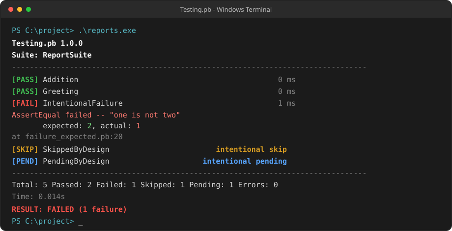

# Testing.pb

**Русский** | [English](../README.md)

Фреймворк для модульного тестирования программ на PureBasic.
Без внешних зависимостей, без установки модулей, без
обязательной настройки.



## Содержание

1. [Что это](#что-это)
2. [Быстрый старт](#быстрый-старт)
3. [Жизненный цикл теста и статусы](#жизненный-цикл-теста-и-статусы)
4. [Проверки (assertions)](#проверки-assertions)
5. [Хуки BeforeEach и AfterEach](#хуки-beforeeach-и-aftereach)
6. [Пропуск, pending и ошибки](#пропуск-pending-и-ошибки)
7. [Запуск и коды выхода](#запуск-и-коды-выхода)
8. [Вывод в терминал](#вывод-в-терминал)
9. [Компиляторные директивы](#компиляторные-директивы)
10. [Лог-файл](#лог-файл)
11. [JSON-отчёт](#json-отчёт)
12. [JUnit XML](#junit-xml)
13. [CI](#ci)
14. [Публичный API](#публичный-api)
15. [Тестирование самого фреймворка](#тестирование-самого-фреймворка)
16. [Примеры](#примеры)
17. [Ограничения](#ограничения)
18. [Версионирование](#версионирование)
19. [Лицензия](#лицензия)

## Что это

`Testing.pbi` — небольшой, но полноценный фреймворк модульного тестирования
для PureBasic. Он подключается одной строкой:

```purebasic
IncludeFile "Testing.pbi"
```

Не требует ни отдельного исполняемого файла, ни настройки проекта, ни
`UseModule`. Все проверки пишут результат во внутреннюю модель, а рендереры
(консоль, лог, JSON, JUnit) только читают её. Поэтому один и тот же прогон
можно одновременно показать человеку и отдать CI.

Ключевые особенности:

- один файл, никаких зависимостей и внешних модулей;
- минимальный тест остаётся коротким: `Test()` → проверки → `EndTest()`;
- статусы `passed`, `failed`, `skipped`, `pending`, `error`;
- диагностика с ожидаемым/фактическим значением, описанием, файлом и строкой;
- `BeforeEach`/`AfterEach`; `AfterEach` выполняется и после падения теста;
- цветной вывод через `ConsoleColor()` и полностью ASCII-оформление;
- UTF-8-исходники и полная поддержка Unicode в консоли, логе, JSON и JUnit,
  включая эмодзи и суррогатные пары;
- лог-файл, JSON и JUnit XML;
- коды выхода, пригодные для CI;
- собственный набор тестов и скрипты запуска.

## Быстрый старт

Создайте файл `tests.pb` рядом с `Testing.pbi`:

```purebasic
EnableExplicit
IncludeFile "Testing.pbi"

Test(Addition)
  AssertEqual(2 + 2, 4)
EndTest(Addition)

Test(Greeting)
  Define greeting.s = "Hello, PureBasic"
  AssertStrEqual(greeting, "Hello, PureBasic")
EndTest(Greeting)

RunAll()
```

Скомпилируйте как консольную программу и запустите:

```text
pbcompiler tests.pb /OUTPUT tests.exe /CONSOLE
tests.exe
```

Вывод по умолчанию:

```text
Testing.pb 1.0.0
Suite: Default
--------------------------------------------------------------------------------
[PASS] Addition                                                             0 ms
[PASS] Greeting                                                             0 ms
--------------------------------------------------------------------------------
Total: 2  Passed: 2  Failed: 0  Skipped: 0  Pending: 0  Errors: 0
Time:    0.000s
RESULT: OK
```

`RunAll()` по умолчанию завершает процесс с кодом `0` при успехе и `1` при
провале или ошибке. Если нужно продолжить работу после прогона, используйте
`RunAll(#False)` — функция вернёт `#True`/`#False`, а код выхода процесса
останется за вами.

## Жизненный цикл теста и статусы

Тест объявляется макросами:

```purebasic
Test(MyTest)
  ; проверки
EndTest(MyTest)
```

`EndTest` регистрирует процедуру. Имена тестов должны быть уникальными
идентификаторами PureBasic; повторное объявление даёт ошибку компиляции.

Статусы ровно такие:

| Статус    | Тег      | Значение                                    |
| --------- | -------- | ------------------------------------------- |
| `passed`  | `[PASS]` | тест дошёл до конца без провалов            |
| `failed`  | `[FAIL]` | проверка не прошла                          |
| `skipped` | `[SKIP]` | тест пропущен через `SkipTest("причина")`   |
| `pending` | `[PEND]` | тест отложен через `PendingTest("причина")` |
| `error`   | `[ERR]`  | явная ошибка через `FailTest("сообщение")`  |

`skipped` и `pending` не считаются провалом: `RESULT: OK`, код выхода `0`.
`failed` и `error` дают `RESULT: FAILED (...)`, код выхода `1`.

Упавшая проверка немедленно завершает текущий тест (`ProcedureReturn
#False`), но не останавливает весь набор: следующие тесты выполняются,
`AfterEach` тоже выполняется. Поэтому проверки нельзя использовать вне
процедуры теста или хука.

## Проверки (assertions)

Все проверки принимают необязательное описание — оно попадёт в диагностику
и в отчёты.

| Макрос                                                                    | Что проверяет                              |
| ------------------------------------------------------------------------- | ------------------------------------------ |
| `Assert(expression, description = "")`                                    | выражение истинно                          |
| `AssertEqual(actual, expected, description = "")`                         | числа равны                                |
| `AssertNotEqual(actual, notExpected, description = "")`                   | числа не равны                             |
| `AssertBigger(actual, threshold, description = "")`                       | `actual > threshold`                       |
| `AssertSmaller(actual, threshold, description = "")`                      | `actual < threshold`                       |
| `AssertInRange(actual, max, min = 0, description = "")`                   | `min <= actual <= max`                     |
| `AssertApproxEqual(actual, expected, epsilon, description = "")`          | числа близки с допуском                    |
| `AssertStrEqual(actual, expected, description = "")`                      | строки равны                               |
| `AssertStrNotEqual(actual, notExpected, description = "")`                | строки не равны                            |
| `AssertStrContains(haystack, needle, description = "")`                   | подстрока найдена                          |
| `AssertNull(pointer, description = "")`                                   | указатель равен `0`                        |
| `AssertNotNull(pointer, description = "")`                                | указатель не равен `0`                     |
| `AssertListEqual(actualList, expectedList, description = "")`             | списки равны поэлементно                   |
| `AssertStrListEqual(actualList, expectedList, description = "")`          | строковые списки равны, с показом различия |
| `AssertStructureEqual(actual, expected, StructureName, description = "")` | структуры равны через `CompareStructure()` |

Важные детали:

- `AssertEqual` предназначен для чисел и использует `Str()` для диагностики.
  Для строк используйте `AssertStrEqual`: в PureBasic нет универсального
  преобразования числа и строки одним `Str()`.
- `AssertInRange` принимает сначала максимум, затем минимум:
  `AssertInRange(value, 10, 1)`.
- `AssertApproxEqual` падает на `NaN` и при `Abs(actual - expected) > epsilon`.
  Допуск должен быть неотрицательным.
- Списки передаются **без скобок**: `AssertListEqual(actual, expected)`, а не
  `actual()`. Макрос сравнивает размеры и элементы и восстанавливает текущий
  элемент списка, который был выбран до проверки.
- `AssertStructureEqual` сравнивает переменные структур:
  `AssertStructureEqual(left, right, MyStructure)`. Для вложенных массивов,
  списков и карт действуют правила `CompareStructure()` PureBasic.
- `AssertNull`/`AssertNotNull` рассчитаны на указатели. Для проверки
  целочисленного нуля используйте `AssertEqual`.

Пример диагностики:

```text
[FAIL] IntentionalFailure                                                   0 ms
       AssertEqual failed -- "one is not two"
       expected: 2, actual: 1
       at failure_expected.pb:23
```

## Хуки BeforeEach и AfterEach

```purebasic
Global g_connection.i

BeforeEach()
  g_connection = 1
EndBeforeEach()

AfterEach()
  g_connection = 0
EndAfterEach()
```

- `BeforeEach` выполняется перед каждым тестом.
- `AfterEach` выполняется после каждого теста, **в том числе после провала,
  `SkipTest`, `PendingTest` и `FailTest`**.
- Хуки могут использовать проверки. Если упадёт `BeforeEach`, тело теста не
  выполняется, но `AfterEach` всё равно вызывается.
- Поддерживается по одному `BeforeEach` и одному `AfterEach` на программу.
- Если `AfterEach` добавит провал после успешного теста, итоговый статус теста
  станет `failed`.

## Пропуск, pending и ошибки

```purebasic
Test(NeedsDatabase)
  SkipTest("нет тестовой БД")
EndTest(NeedsDatabase)

Test(NewFeature)
  PendingTest("будет в 2.0")
EndTest(NewFeature)

Test(BrokenFixture)
  FailTest("фикстура не загрузилась")
EndTest(BrokenFixture)
```

- `SkipTest(reason = "")` — статус `skipped`.
- `PendingTest(reason = "")` — статус `pending`.
- `FailTest(message = "")` — статус `error` (не провал проверки, а явная
  ошибка теста/инфраструктуры).
- Все три макроса завершают текущий тест через `ProcedureReturn`; `AfterEach`
  при этом всё равно выполняется.
- Причина/сообщение показываются в консоли, логе, JSON и JUnit.

## Запуск и коды выхода

```purebasic
RunAll()            ; запустить всё и завершить процесс кодом 0/1
RunAll(#False)      ; запустить всё, вернуть #True/#False, не завершать процесс
Run(MyTest)         ; запустить один тест по идентификатору
```

`RunAll()`:

- очищает предыдущую модель результатов;
- печатает заголовок и все тесты;
- пишет лог и отчёты, если они включены;
- при `exitAfter = #True` вызывает `End 0` или `End 1`.

Коды выхода:

| Итог                                        | Код |
| ------------------------------------------- | --- |
| все тесты `passed`, `skipped` или `pending` | `0` |
| есть хотя бы один `failed` или `error`      | `1` |

`RunAll(#False)` возвращает `#True`, если провалов и ошибок нет. Код выхода
процесса в этом случае не меняется: вызовите `End` сами, если он нужен CI.

`Run(MyTest)` принимает идентификатор, а не строку. Он печатает собственный
заголовок/итог, пишет отчёты и возвращает `#True` для `passed`/`skipped`/
`pending`, `#False` для `failed`/`error`/неизвестного имени. `Run` не вызывает
`End`.

`Suite("Имя")` задаёт имя набора; без него используется `Default`:

```purebasic
Suite("Unit tests")
```

Имя можно задать и директивой `#TESTING_SUITE$`.

## Вывод в терминал

Формат рассчитан на 80–120 колонок:

- поле статуса шириной 7 символов: `[PASS]`, `[FAIL]`, `[SKIP]`, `[PEND]`,
  `[ERR]`;
- время выровнено вправо, минимум 5 цифр, затем ` ms`;
- у `skipped`/`pending` вместо времени печатается причина;
- детали провала имеют отступ 7 пробелов;
- итоговая строка `Total: ... Passed: ...` — одна строка;
- последняя строка — `RESULT: OK` или `RESULT: FAILED (...)`.

Цвет:

- по умолчанию цвет включается только если стандартный вывод — терминал
  (TTY); при перенаправлении в файл или канал цвет выключается;
- используется `ConsoleColor()`, без ручных ANSI-последовательностей;
- `NO_COLOR` (любое непустое значение) и `#TESTING_NO_COLOR` выключают цвет;
- `#TESTING_ASCII` выключает цвет и включает ASCII-оформление;
- `#TESTING_COLOR_ON` включает цвет принудительно, `#TESTING_COLOR_OFF` —
  выключает;
- приоритет: `#TESTING_NO_COLOR`/`NO_COLOR` → `#TESTING_ASCII` →
  `#TESTING_COLOR_ON` → `#TESTING_COLOR_OFF` → авто.

По умолчанию разделители — ASCII-дефисы. Это делает вывод безопасным в старом
`cmd.exe`, файлах и CI-логах. `#TESTING_UNICODE` включает символ `─` для
разделителей (только оформление; текст пользователя может быть Unicode в
любом режиме).

### Unicode и кодировка исходников

Unicode-имена тестов, описания, ожидаемые/фактические значения и причины
пропуска сохраняются везде: в консоли, логе, JSON и JUnit. На Windows реальная
консоль автоматически переключается на кодовую страницу 65001;
перенаправленный вывод пишется в UTF-8.

- Любой `.pb`/`.pbi` с не-ASCII литералами сохраняйте как **UTF-8 с BOM**.
  Иначе PureBasic 6.41 декодирует файл системной ANSI-кодировкой (например,
  CP1251), и литералы превращаются в «кракозябры». BOM работает и во
  включаемых файлах вроде `Testing.pbi`.
- Внутри PureBasic строка — UTF-16: `Len`, `Mid` и `Asc` считают единицы
  UTF-16. Эмодзи занимает две единицы, поэтому `Len("😀")` равно `2`.
- `Chr()` принимает только BMP-символы до `$FFFF`. Эмодзи вставляйте прямо в
  UTF-8-литерал исходника, а не собирайте через `Chr()`.
- `#TESTING_ASCII` меняет только оформление и никогда не заменяет Unicode-текст
  пользователя на `?`.
- Выравнивание колонок использует `Len`, поэтому широкие CJK-глифы могут
  сдвинуть правую колонку времени. Текст и данные отчётов остаются корректными.

ASCII-пример:

```text
Testing.pb 1.0.0
Suite: AsciiOnly
--------------------------------------------------------------------------------
[PASS] PassAscii                                                            0 ms
[FAIL] FailAscii                                                            0 ms
       AssertEqual failed -- "plain ascii description"
       expected: 2, actual: 1
       at ascii_only_expected.pb:19
--------------------------------------------------------------------------------
Total: 2  Passed: 1  Failed: 1  Skipped: 0  Pending: 0  Errors: 0
Time:    0.000s
RESULT: FAILED (1 failure)
```

### Режимы вывода

| Директива           | Поведение                                                                      |
| ------------------- | ------------------------------------------------------------------------------ |
| `#TESTING_QUIET`    | скрывает заголовок и строки успешных тестов; провалы, итог и `RESULT` остаются |
| `#TESTING_VERBOSE`  | печатает трассировку тестов/хуков и каждую деталь провала на отдельной строке  |
| `#TESTING_PROGRESS` | показывает прогресс `[i/n]` только в TTY и только вне quiet-режима             |

Даже в quiet-режиме лог-файл (если он включён) содержит полный отчёт.

## Директивы компилятора

Все директивы необязательны и объявляются **до** `IncludeFile "Testing.pbi"`.
Пользовательский код не должен содержать `CompilerIf` для флагов: фреймворк
делает это сам.

| Директива                  | Назначение                                          |
| -------------------------- | --------------------------------------------------- |
| `#TESTING_QUIET`           | тихий консольный вывод                              |
| `#TESTING_VERBOSE`         | подробная диагностика и трассировка                 |
| `#TESTING_PROGRESS`        | индикатор прогресса (только TTY)                    |
| `#TESTING_NO_COLOR`        | запретить цвет                                      |
| `#TESTING_ASCII`           | ASCII-оформление и запрет цвета                     |
| `#TESTING_UNICODE`         | Unicode-разделители                                 |
| `#TESTING_COLOR_ON`        | принудительный цвет                                 |
| `#TESTING_COLOR_OFF`       | принудительно без цвета                             |
| `#TESTING_LOG_FILE$`       | путь к лог-файлу                                    |
| `#TESTING_SUITE$`          | имя набора по умолчанию                             |
| `#TESTING_OUTPUT_JSON`     | включить JSON-отчёт                                 |
| `#TESTING_JSON_FILE$`      | путь JSON (по умолчанию `testing-results.json`)     |
| `#TESTING_OUTPUT_JUNIT`    | включить JUnit-отчёт                                |
| `#TESTING_JUNIT_FILE$`     | путь JUnit (по умолчанию `testing-results.xml`)     |
| `#TESTING_NO_OPEN_CONSOLE` | не вызывать `OpenConsole()` (встраивание/свой хост) |

Пример:

```purebasic
#TESTING_OUTPUT_JSON = 1
#TESTING_JSON_FILE$ = "artifacts/results.json"
#TESTING_OUTPUT_JUNIT = 1
#TESTING_JUNIT_FILE$ = "artifacts/results.xml"
#TESTING_LOG_FILE$ = "artifacts/tests.log"

IncludeFile "Testing.pbi"
```

Лог и консоль используют один и тот же текст в UTF-8. `#TESTING_ASCII` меняет
только оформление, поэтому Unicode-имена, сообщения и причины пропуска
сохраняются.

Файлы лога и отчётов перезаписываются при каждом прогоне. Недостающие
каталоги в путях создаются автоматически. Повторный `RunAll(#False)` в одном
процессе допустим, но файлы будут содержать результат последнего прогона.

## Лог-файл

`#TESTING_LOG_FILE$` пишет полный отчёт в файл:

- всегда без цвета и без ANSI-последовательностей;
- UTF-8 без BOM, с сохранением кириллицы, CJK, эмодзи и другого Unicode;
- содержит заголовок, все тесты (включая успешные) и итог даже в quiet-режиме;
- никогда не заменяет не-ASCII символы на `?`.

Лог подходит для артефактов CI, редакторов и `grep -a`. ASCII-оформление
используйте, только если старый терминал не отображает Unicode-разделители.

## JSON-отчёт

Включение:

```purebasic
#TESTING_OUTPUT_JSON = 1
#TESTING_JSON_FILE$ = "results.json"
```

Схема (`schema_version` = 1)

```json
{
  "schema_version": 1,
  "framework": "Testing.pb",
  "suite": "Unit tests",
  "duration_ms": 14,
  "summary": {
    "total": 5, "passed": 2, "failed": 1,
    "skipped": 1, "pending": 1, "errors": 0
  },
  "tests": [
    {
      "name": "Addition",
      "status": "passed",
      "duration_ms": 0,
      "message": "",
      "description": "",
      "expected": "",
      "actual": "",
      "file": "",
      "line": 0
    },
    {
      "name": "IntentionalFailure",
      "status": "failed",
      "duration_ms": 1,
      "message": "AssertEqual failed -- one is not two",
      "description": "one is not two",
      "expected": "2",
      "actual": "1",
      "file": "C:\\project\\tests.pb",
      "line": 20
    }
  ]
}
```

Правила:

- UTF-8 без BOM, валидный JSON;
- `status`: `passed`, `failed`, `skipped`, `pending`, `error`;
- `message` — короткое сообщение; если есть описание, оно добавляется через
  ` -- ` для удобства читателя;
- `description` — описание, переданное в проверку/`SkipTest`/`PendingTest`;
- `expected`/`actual` — строки, уже приведённые к тексту;
- `file`/`line` — точка компиляции (`#PB_Compiler_File`/`#PB_Compiler_Line`);
- у успешных тестов `file` пустой, `line` = 0;
- потребители должны игнорировать неизвестные поля: схема может дополняться
  обратно совместимо в пределах `schema_version = 1`.

## JUnit XML

Включение:

```purebasic
#TESTING_OUTPUT_JUNIT = 1
#TESTING_JUNIT_FILE$ = "results.xml"
```

Структура:

```xml
<?xml version="1.0" encoding="UTF-8"?>
<testsuites name="Unit tests" tests="5" failures="1" errors="0" skipped="2" time="0.014">
  <testsuite name="Unit tests" tests="5" failures="1" errors="0" skipped="2" time="0.014">
    <testcase classname="Unit tests" name="Addition" time="0.000"/>
    <testcase classname="Unit tests" name="IntentionalFailure" time="0.001">
      <failure message="AssertEqual failed -- one is not two" type="AssertionFailed">...</failure>
    </testcase>
    <testcase classname="Unit tests" name="SkippedOne" time="0.000">
      <skipped message="no network"/>
    </testcase>
  </testsuite>
</testsuites>
```

Соответствие статусов:

| Статус Testing.pb | JUnit                                                           |
| ----------------- | --------------------------------------------------------------- |
| `passed`          | успешный `testcase`                                             |
| `failed`          | `<failure type="AssertionFailed">` с деталями                   |
| `error`           | `<error type="Error">`                                          |
| `skipped`         | `<skipped message="..."/>`                                      |
| `pending`         | `<skipped message="..."/>` (CI считает отложенные пропущенными) |

`skipped` в атрибутах включает и `skipped`, и `pending`. Время — секунды с
тремя знаками после точки. XML экранируется; управляющие символы, недопустимые
в XML, заменяются пробелом.

## CI

`RunAll()` уже возвращает нужный код выхода. Минимальный шаг CI:

```text
pbcompiler tests.pb /OUTPUT tests.exe /CONSOLE
tests.exe
```

Для GitHub Actions, GitLab CI, Jenkins и других систем этого достаточно:
успешный прогон — `0`, провал/ошибка — `1`. Для артефактов включите JSON
и/или JUnit:

```purebasic
#TESTING_OUTPUT_JUNIT = 1
#TESTING_JUNIT_FILE$ = "test-results.xml"
#TESTING_OUTPUT_JSON = 1
#TESTING_JSON_FILE$ = "test-results.json"
#TESTING_ASCII = 1
```

`#TESTING_ASCII` рекомендуется для CI-логов, которые смотрят в старых
терминалах: оформление не зависит от поддержки Unicode-глифов. Сам лог при
этом остаётся UTF-8 и сохраняет текст тестов.

## Публичный API

### Макросы

Глобальные, `UseModule` не требуется:

- `Test(Name)`, `EndTest(Name)`
- `BeforeEach()`, `EndBeforeEach()`
- `AfterEach()`, `EndAfterEach()`
- `Suite("Name")`
- `RunAll(exitAfter = #True)`
- `Run(TestName)`
- `SkipTest(reason = "")`, `PendingTest(reason = "")`, `FailTest(message = "")`
- все проверки из таблицы выше

### Процедуры модуля `Testing`

```purebasic
Testing::SetColor(Testing::#TESTING_COLOR_PASS)
Testing::ResetColor()

Define escaped.s = Testing::JsonEscape("a" + Chr(34) + "b")
Define escaped2.s = Testing::JsonEscapeString("a" + Chr(9) + "b")
Define xml.s = Testing::XmlEscapeString("a&b")

Testing::Prepare()   ; открыть консоль и определить TTY/ширину заранее
Testing::IsColorEnabled()   ; #True, если следующий вывод будет цветным
```

`JsonEscape` возвращает экранированную строку **без** окружающих кавычек;
`JsonEscapeString` — совместимый псевдоним. `XmlEscapeString` экранирует
`& < > " '` и недопустимые управляющие символы.

С `UseModule Testing` доступны короткие имена процедур и константы:

```purebasic
UseModule Testing
SetColor(#TESTING_COLOR_PASS)
ResetColor()
Define v.s = #TESTING_VERSION$
```

Константы:

- версия: `#TESTING_VERSION$` (`"1.0.0"`);
- статусы: `#TESTING_STATUS_RUNNING`, `..._PASSED`, `..._FAILED`,
  `..._SKIPPED`, `..._PENDING`, `..._ERROR`;
- цвета: `#TESTING_COLOR_DEFAULT`, `..._PASS`, `..._FAIL`, `..._SKIP`,
  `..._PENDING`, `..._HEADER`, `..._NAME`, `..._DIM`, `..._OK`, `..._ERROR`.

Дополнительные функции конфигурации (обычно не нужны, если используются
директивы): `ConfigureQuiet`, `ConfigureVerbose`, `ConfigureProgress`,
`SetAsciiMode`, `SetColorMode`, `SetLogFile`, `EnableJSON`, `EnableJUnit`,
`SetOpenConsole`. Они позволяют настроить фреймворк во время выполнения.

### Структуры

Публичные структуры `TestingResult` и `TestingSuiteResult` описывают модель
результатов. Все рендереры читают эту модель; проверки ничего не печатают
сами.

## Тестирование самого фреймворка

В репозитории есть собственный набор тестов (`tests/`). Он проверяет
положительные сценарии, все виды провалов, хуки, skip/pending/error,
повторный запуск, вложенные макросы, ASCII-оформление, UTF-8-литералы,
Unicode в консоли/логе/JSON/JUnit и лог-файл.

Полный набор запускается через [Task](https://taskfile.dev) (команда `task`,
версия 3+):

```bash
task test                 # все найденные компиляторы, fasm и C
task fasm                 # только fasm
task c                    # только C
task x64                  # только x64
task x86                  # только x86
task clean                # удалить tests/.build
```

Пути к компиляторам необязательны; можно указать exe или его каталог:

```bash
task test PB_X64="C:\PureBasic\Compilers\pbcompiler.exe" PB_C64="C:\PureBasic\Compilers"
```

На POSIX аналогично используются `PB_UNIX` и `PB_UNIX_C`. Переменные
`PB_ARCH`, `PB_BACKEND`, `PB_X64`, `PB_C64` и другие можно также задать в
окружении. Ненайденный автоопределённый компилятор пропускается, явно указанный
несуществующий путь считается ошибкой. Если не запустился ни один компилятор,
`task` завершается с ненулевым кодом (раннеры напрямую — с кодом `1`).

Windows напрямую:

```powershell
powershell -NoProfile -ExecutionPolicy Bypass -File .\run-tests.ps1
```

По умолчанию проверяются обе архитектуры (x64 и x86) с fasm-бэкендом.
Дополнительные режимы и явные пути:

```powershell
powershell -NoProfile -ExecutionPolicy Bypass -File .\run-tests.ps1 -Architecture x64
powershell -NoProfile -ExecutionPolicy Bypass -File .\run-tests.ps1 -Architecture x86
powershell -NoProfile -ExecutionPolicy Bypass -File .\run-tests.ps1 -Backend both
powershell -NoProfile -ExecutionPolicy Bypass -File .\run-tests.ps1 `
  -CompilerX64 "C:\PureBasic\Compilers" -CompilerC64 "C:\PureBasic\Compilers"
```

Параметры `-CompilerX64`, `-CompilerX86`, `-CompilerC64`, `-CompilerC86`
заменяют автоопределение. Эквивалентные переменные окружения:
`PB_COMPILER_X64`, `PB_COMPILER_X86`, `PB_COMPILER_C_X64`,
`PB_COMPILER_C_X86`.

Linux/macOS напрямую:

```bash
PB_COMPILER=pbcompiler ./run-tests.sh
PB_COMPILER_C=pbcompilerc PB_BACKEND=both ./run-tests.sh
```

Task, PowerShell- и POSIX-раннеры возвращают `0`, только если прошли все
проверки. Они также компилируют и запускают примеры из `examples/`.

## Примеры

- `examples/basic/basic.pb` — минимальный тест.
- `examples/assertions/assertions.pb` — все основные виды проверок.
- `examples/hooks/hooks.pb` — `BeforeEach`/`AfterEach`.
- `examples/reports/reports.pb` — JSON, JUnit и лог.

Запускайте пример из каталога, доступного для записи, если он создаёт отчёты.

## Ограничения

- Нет перехвата аппаратных исключений и падений процесса: `error` — это явный
  `FailTest`, а не crash. При аварийном завершении `AfterEach` не выполнится.
- Аргументы проверок могут вычисляться дважды при провале: сначала в условии,
  затем при построении диагностики. Не передавайте выражения с побочными
  эффектами.
- Один набор на процесс: `Suite`/`#TESTING_SUITE$` задают глобальное имя.
  `RunAll` можно вызывать повторно, но отчёты перезаписываются.
- `AssertEqual` — только для чисел; строки сравнивайте `AssertStrEqual`.
- Списки передаются по имени без скобок; это макросы, а не универсальные
  функции.
- Параллельного выполнения тестов нет.
- `#TESTING_PROGRESS` работает только в TTY; при перенаправлении прогресса нет.
- Все исходники `.pb`/`.pbi` проекта — UTF-8 с BOM. Свои тестовые файлы с
  не-ASCII литералами сохраняйте так же: PureBasic 6.41 распознаёт UTF-8 только
  по BOM, иначе использует системную ANSI-кодировку.
- Unicode-разделители и глифы зависят от шрифта терминала; для старых
  `cmd.exe` используйте ASCII-оформление. Консоль, лог, JSON и JUnit сохраняют
  Unicode-текст.
- Фреймворк проверен на PureBasic 6.41 (Windows x64/x86, fasm и C-бэкенды).
  Другие версии 6.x могут работать, но не тестировались в этом репозитории.
  Для Linux/macOS есть переносимые ветки кода и POSIX-раннер.

## Версионирование

Используется Semantic Versioning: `MAJOR.MINOR.PATCH`.

- **MAJOR** — несовместимое изменение публичных макросов/процедур, структуры
  результатов или контракта вывода/отчётов.
- **MINOR** — новые проверки, директивы, поля отчётов и другие обратно
  совместимые возможности.
- **PATCH** — исправления ошибок, документация, внутренние улучшения без
  изменения API.

Версия фреймворка хранится в `Testing::#TESTING_VERSION$`

## Лицензия

GNU General Public License v3.0. См. [LICENSE](../../LICENSE).
